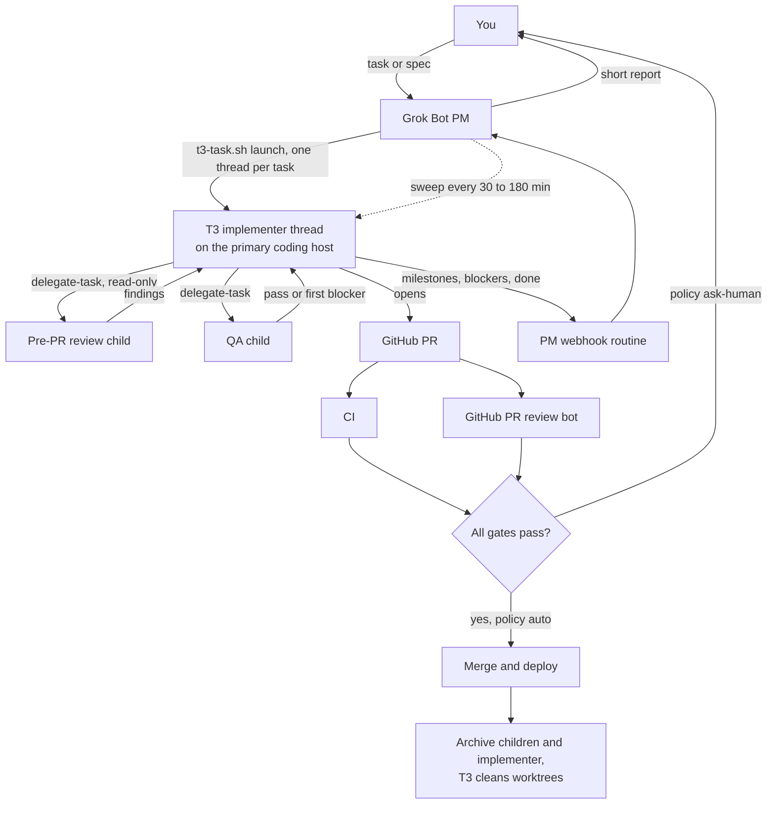

# grokbot-t3-orchestration

Let a Grok Bot run software development in [T3 Code](https://github.com/pingdotgg/t3code).

The bot acts as the project manager. It plans the work, launches one T3 implementer thread per task, tracks progress and reports back to you. The implementer thread owns the task end to end: it writes the code, delegates its own pre-PR review and QA children, opens the PR, and merges once every gate passes (or asks you first, if you prefer). Webhooks tell the bot when something happens, a monitoring sweep catches anything the webhooks miss, and clear hygiene rules keep threads, worktrees and disks tidy.

Everything here is configurable. Model choices, hosts, repos, merge policy and cost limits live in one `config.json`.

## What's in the repo

| Path | What it is |
|---|---|
| [`skills/t3-orchestration`](skills/t3-orchestration/SKILL.md) | The main Grok Bot skill: how the PM bot runs work in T3. |
| [`skills/t3-setup`](skills/t3-setup/SKILL.md) | Walks the bot (and you) through installing and connecting T3. |
| [`skills/t3-pm-sweep`](skills/t3-pm-sweep/SKILL.md) | The recurring monitoring routine. |
| [`scripts/`](scripts) | `t3-task.sh` and friends: launch, send (queue or steer), list, status, archive. Plus `notify-pm.sh` for webhooks. |
| [`templates/`](templates) | Implementer, review and QA brief templates, and a webhook payload example. |
| [`docs/`](docs) | Setup, orchestration, model routing, hygiene, webhooks and monitoring. |
| [`config.example.json`](config.example.json) | Environments, projects, model routing, merge policy, cost guardrails. |

## How it works



1. **You give the bot a task.** The bot is the PM. It never writes code itself.
2. **One implementer thread per task.** The bot launches it with an explicit model, a short plain-English title and a full brief built from [`templates/implementer-brief.md`](templates/implementer-brief.md).
3. **The implementer delegates.** It opens a read-only review child before the PR, fixes valid findings, then a QA child with a test plan and hard limits. The PM bot never launches reviewers itself.
4. **PR and gates.** CI, the pre-PR review, QA and a GitHub PR review bot must all pass with findings resolved. Then the implementer merges, or asks you, depending on `policy.merge`.
5. **Webhooks and a sweep.** The implementer posts milestones, blockers and completion to the PM bot's webhook. A routine sweeps live threads as a backstop.
6. **Wrap-up.** Once threads settle, children are archived, the implementer is archived after merge, and T3's own cleanup removes the worktree.

## Quick start

1. **Install T3 Code** on an always-on Linux host, sign in your coding harnesses with subscriptions, and make it reachable from the bot (Tailscale is the easy route). See [docs/setup.md](docs/setup.md).
2. **Give the bot this repo.** Clone it onto the bot's box, then install the deps:
   ```sh
   git clone https://github.com/dkapo88/grokbot-t3-orchestration.git
   cd grokbot-t3-orchestration/scripts && npm ci --ignore-scripts
   ```
3. **Configure.** `cp config.example.json config.json`, then fill in your environments, projects and model routing. Put the T3 session token in `secrets/<env>.token` (mode 600). Never paste it in chat.
4. **Install the skills.** Copy `skills/*` into your bot's skills, or ask the bot: "install the skills from grokbot-t3-orchestration".
5. **Check it works.**
   ```sh
   ./scripts/t3-task.sh --env primary list
   ./scripts/t3-task.sh --env primary launch /home/dev/repos/web-app --role implement \
     --title "Fix signup button spacing" --brief-file brief.md --dry-run
   ```
6. **Set up the webhook routine** for the PM bot and a sweep routine. See [docs/webhooks-and-monitoring.md](docs/webhooks-and-monitoring.md).

## Principles

- **One thread per task.** Never a long-running mega-thread across tasks.
- **The implementer owns review and QA.** The PM bot talks only to implementer threads.
- **Explicit models, no silent fallbacks.** Every launch names the harness, model and options. If a model errors, the thread stops and reports.
- **Steer or queue on purpose.** `--steer` changes what the running turn is doing now; `--queue` (default) is the next step after it.
- **Plain-English thread titles.** 3 to 7 words a non-engineer would understand.
- **Settle, then archive.** Nothing is wrapped up while a run is live or a message is queued.
- **Secrets by name only.** Briefs and webhooks name environment variables, never values.

## Docs

- [Setup and installation](docs/setup.md)
- [Orchestration](docs/orchestration.md)
- [Model routing](docs/model-routing.md)
- [Hygiene and cleanup](docs/hygiene.md)
- [Webhooks and monitoring](docs/webhooks-and-monitoring.md)

## Credits

Some ideas are adapted from [T3 Tots](https://github.com/Deepusleepy/t3-tots) (MIT): risk-tiered approvals (bots accept only low and normal risk), nudging a stalled thread once, resume-at-reset after usage limits, read-only access to T3's database, a strict list of secret files never to open, and the optional `t3listen` event push to a webhook. No T3 Tots code is copied here; `t3listen` is used as an optional install from that project.

T3 Code is by [Ping](https://github.com/pingdotgg/t3code). This project is not affiliated with Ping or with xAI.

## License

[MIT](LICENSE)
